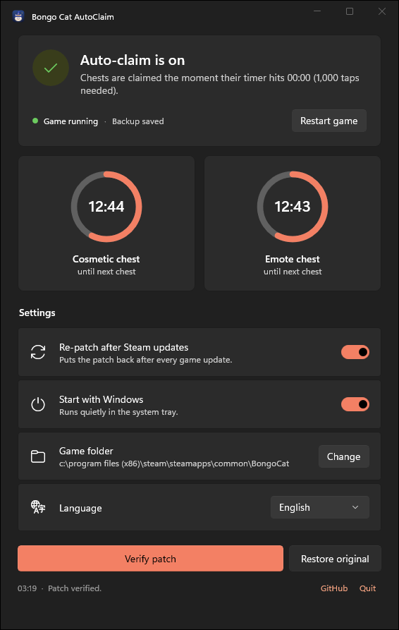
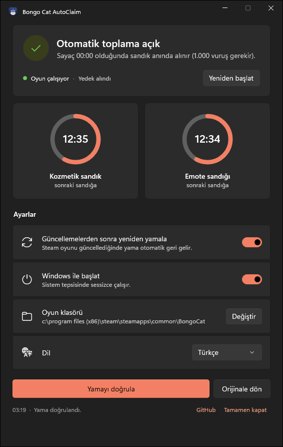
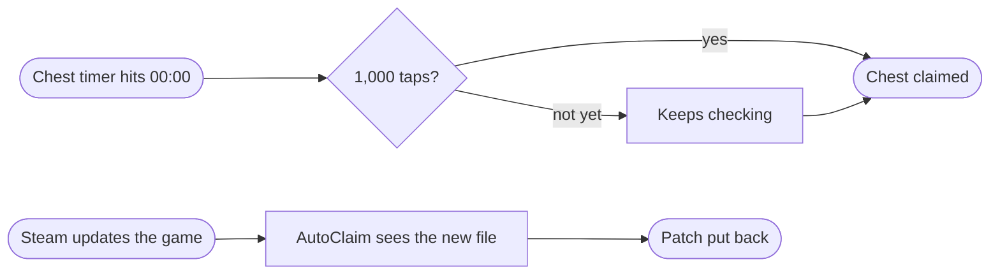

<p align="center">
  
</p>

<p align="center">
  <a href="https://github.com/SwiftExplorer567/BongoCat-AutoClaim/releases/latest"></a>
  <a href="https://github.com/SwiftExplorer567/BongoCat-AutoClaim/releases"></a>
  
  
  <a href="LICENSE"></a>
</p>

<p align="center">
  <a href="https://github.com/SwiftExplorer567/BongoCat-AutoClaim/releases/latest/download/BongoCatAutoClaim.exe"></a>
</p>

<p align="center">
  <a href="https://steamcommunity.com/sharedfiles/filedetails/?id=3843814481">Steam guide</a>
  &nbsp;·&nbsp;
  <a href="#quick-start">Quick start</a>
  &nbsp;·&nbsp;
  <a href="#faq">FAQ</a>
  &nbsp;·&nbsp;
  <a href="#türkçe">Türkçe</a>
</p>

<br>

Bongo Cat gives you a Cosmetic and an Emote chest every 30 minutes, but only if you click the popup. **AutoClaim makes the game claim them by itself the second the timer hits `00:00`.** No auto-clicker, no macro, your mouse stays free.

<p align="center">
  
  
</p>

## Features

<table>
  <tr>
    <td width="33%" valign="top"><b>Hands off</b><br>Nothing moves your mouse or presses keys. Keep gaming or working.</td>
    <td width="33%" valign="top"><b>Fair</b><br>You still need 1,000 taps. No extra chests or drops.</td>
    <td width="33%" valign="top"><b>Survives updates</b><br>When Steam updates the game, the patch is put back from the tray.</td>
  </tr>
  <tr>
    <td valign="top"><b>One-click undo</b><br>Restore the original game file any time.</td>
    <td valign="top"><b>Live timers</b><br>See when your next Cosmetic and Emote chests are ready.</td>
    <td valign="top"><b>Feels native</b><br>Windows 11 design that follows your accent colour and theme. English and Turkish.</td>
  </tr>
</table>

## Quick start

1. **Download** [`BongoCatAutoClaim.exe`](https://github.com/SwiftExplorer567/BongoCat-AutoClaim/releases/latest/download/BongoCatAutoClaim.exe). Nothing to install.
2. **Run it.** It finds your Bongo Cat folder, saves a backup and turns auto-claim on.
3. **Restart the game** if it was open. There's a button for it.

When the top card says **Auto-claim is on**, you're done. Close the window and it keeps watching from the system tray.

> [!NOTE]
> The exe isn't code-signed, so Windows SmartScreen may show "unknown publisher". The full source is here, and you can [build it yourself](#build-from-source).

## How it works



<details>
<summary><b>Technical details</b></summary>

<br>

Bongo Cat is a Unity (Mono) game. Chest timers live in `BongoCat.Shop` inside `BongoCat_Data\Managed\Assembly-CSharp.dll`. When a chest comes off cooldown, `OnChestReady()` only shows the popup (`_shopVisuals.Show()`) and waits for a click (`OnClick()` → `_shopItem.Buy()`).

AutoClaim patches two methods in place:

1. **`BongoCat.Shop::OnChestReady()`**: after `SendChestReady(true)`, it runs
   ```csharp
   if (this.CanGetShownChest)
   {
       this._shopVisuals.Show();
       this._shopItem.Buy();
   }
   ```
   `CanGetShownChest` checks `ChestIsReady && CanAffordChest && ShowChestSetting.Value`, so a chest is only bought when it's off cooldown, affordable and enabled in the game's settings.

2. **`BongoCat.Shop+<TimerUpdate>d__42::MoveNext()`**: drops the `!this._shopVisuals.IsShown` check on the fallback branch, so `OnChestReady()` keeps firing while the popup is already on screen and you're still collecting taps.

The DLL is read with `System.Reflection.Metadata`, so the game's code is never loaded or run. Metadata tokens are resolved each time instead of hard-coded, so the patch keeps working when an update shifts them. Method body sizes stay the same, so metadata tables and exception headers aren't touched. The patched image is checked again before it's written to disk, and the original is kept as `Assembly-CSharp.dll.bak`.

</details>

## FAQ

<details>
<summary><b>How do I go back to the original game?</b></summary>
<br>
Click <b>Restore original</b>. Verifying game files in Steam does the same.
</details>

<details>
<summary><b>Does it change anything else?</b></summary>
<br>
No. It only changes what happens when a chest becomes ready. Taps are spent the same way as a manual click.
</details>

<details>
<summary><b>Why is the exe about 90 MB?</b></summary>
<br>
It bundles .NET and the Windows App SDK, so you don't have to install anything else.
</details>

<details>
<summary><b>Is it safe for my account?</b></summary>
<br>
It changes one local game file. It's still a modification, so use it at your own risk.
</details>

<details>
<summary><b>Command-line options</b></summary>
<br>

| Flag | What it does |
| --- | --- |
| `--minimized` | Start hidden in the system tray (used by "Start with Windows") |
| `--once` | Check and patch once without a window, then exit |

</details>

## Build from source

Built with [WinUI 3](https://github.com/microsoft/WindowsAppSDK) on .NET 10, with [H.NotifyIcon](https://github.com/HavenDV/H.NotifyIcon) for the tray icon and [Windows Community Toolkit](https://github.com/CommunityToolkit/Windows) settings cards. You need the [.NET 10 SDK](https://dotnet.microsoft.com/download):

```cmd
build.bat
```

The single-file exe lands in `dist\`. For ARM PCs, run `set RID=win-arm64` first.

Icons, the banner and the social preview are rendered from the SVGs in `assets/` by `tools/generate_assets.py` (`pip install resvg-py pillow`).

## Türkçe

<details>
<summary><b>Türkçe açıklama</b></summary>

<br>

Steam'deki Bongo Cat için otomatik sandık toplayıcı. Sayaç `00:00` olduğunda sandığa tıklamana gerek kalmadan oyun sandığı kendisi alır. Fareni ya da klavyeni kullanmaz.

**Kurulum**

1. [`BongoCatAutoClaim.exe`](https://github.com/SwiftExplorer567/BongoCat-AutoClaim/releases/latest/download/BongoCatAutoClaim.exe) dosyasını indir. Kurulum gerekmez.
2. Çalıştır. Bongo Cat klasörünü kendisi bulur, yedek alır ve otomatik toplamayı açar.
3. Oyun açıksa **Yeniden başlat** butonuna bas.

Üstteki kartta **Otomatik toplama açık** yazıyorsa her şey hazır. Pencereyi kapatsan da sistem tepsisinden çalışmaya devam eder.

- Yine 1.000 vuruş gerekir, fazladan sandık vermez.
- Steam oyunu güncellediğinde yama otomatik olarak geri yüklenir.
- **Orijinale dön** butonu oyun dosyasını tek tıkla eski haline getirir.
- Arayüz Türkçe ve İngilizce, Ayarlar'daki Dil seçeneğinden değiştirilebilir.

</details>

---

<p align="center">
  <sub>MIT License · Not affiliated with Irox Games, the makers of Bongo Cat, or with Valve.</sub>
</p>
